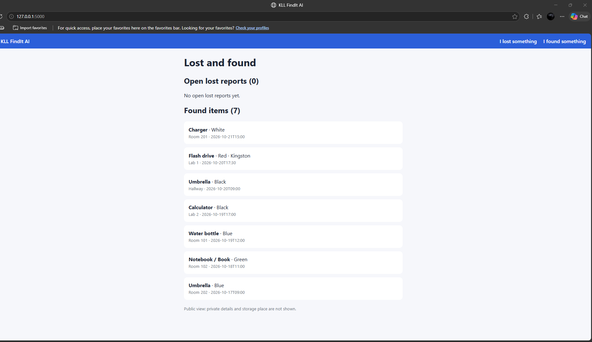
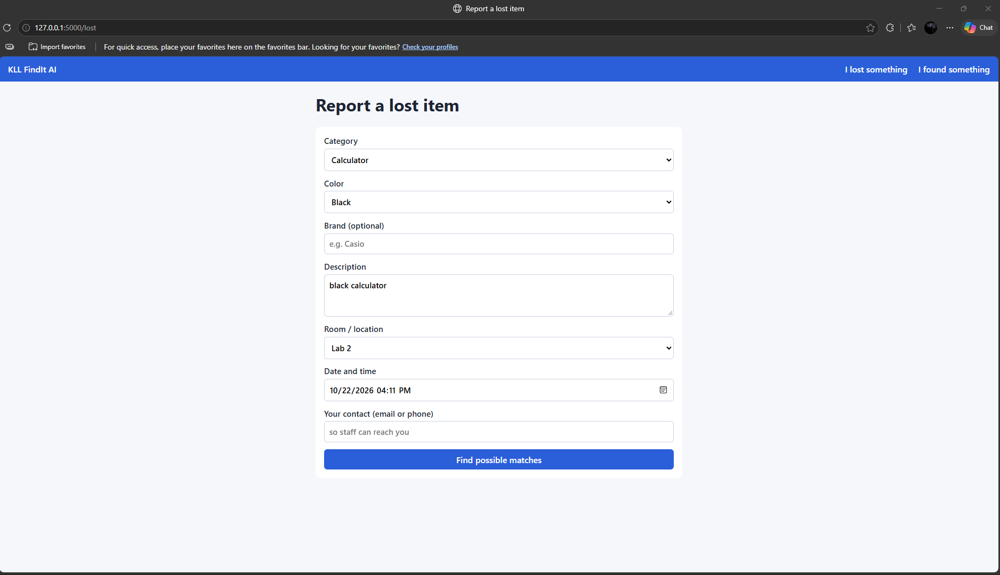
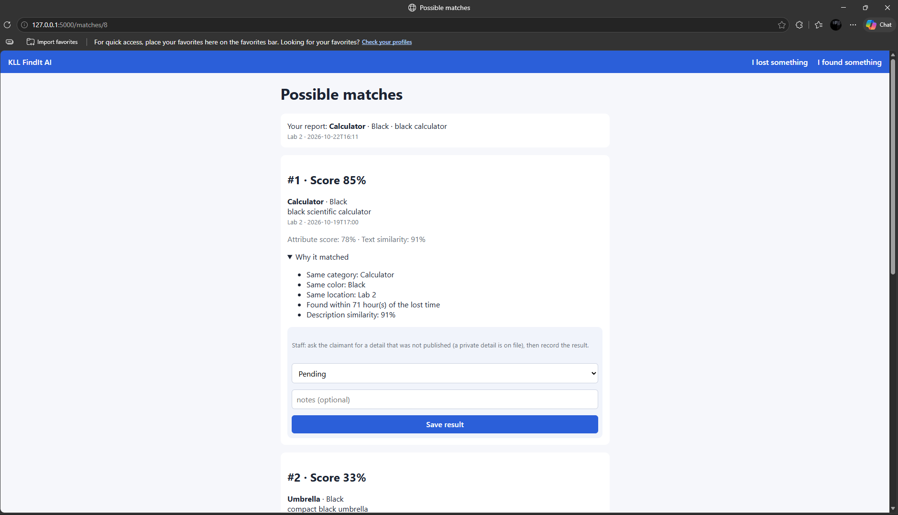

# KLL FindIt AI

lost-and-found matching system for classrooms and laboratories at Kolehiyo ng Lungsod ng Lipa (KLL). Made for **CSE 103 Intelligent System**.

Students and staff leave umbrellas, calculators, flash drives, and chargers in classrooms all the time. FindIt AI keeps a digital record of **lost reports** and **found items**, and suggests the most likely matches by comparing category, color, brand, location, time, and the item description. Staff always verify the owner before an item is released. The system only suggests, it never releases anything by itself.

## Screenshots

**Home page:** open lost reports and the found items list. The public view does not show private details or where an item is stored.



**Report a lost item:** a simple form that also works on a phone browser.



**Possible matches:** the top 3 found items for a lost report, each with a score and the reasons it matched. Staff record the verification result below each match.



## How the matching works

Each found item gets two scores between 0% and 100%:

1. **Attribute score (rule-based).** Compares category (30%), color (20%), brand (10%), location (20%), and how close the times are (20%). If an attribute is blank on either side, for example no brand, it is skipped and the other weights are rescaled, so missing information does not unfairly lower the score.
2. **Text score (AI).** Turns the descriptions into numbers with TF-IDF and measures how similar they are with cosine similarity, using scikit-learn.

The **final score** is 50% attribute score plus 50% text score. The page shows the top 3, with the reasons ("Same category", "Same location", "Description similarity: 91%"). All weights can be changed in `config.py`.

## Tech stack

| Part            | Technology                                       |
| --------------- | ------------------------------------------------ |
| Interface       | HTML, CSS (mobile-friendly web pages)            |
| Backend         | Python 3.13 with Flask                           |
| Database        | SQLite (built into Python, no setup)             |
| AI              | scikit-learn (TF-IDF, cosine similarity), pandas |
| Version control | Git and GitHub                                   |

Everything is free and runs on an ordinary student laptop. No special hardware is needed.

---

## Get the project on your laptop (step by step, Windows)

Do these steps in order. Use **Command Prompt** (press the Windows key, type `cmd`, press Enter).

### Step 1: Install the tools (one time)

You need Python 3.13, Git, and (recommended) VS Code.

1. **Python 3.13:** go to https://www.python.org/downloads/windows/ and under **Stable Releases** choose **Python 3.13.x** and click **Windows installer (64-bit)**.
   - On the first screen of the installer, **tick "Add python.exe to PATH"** at the bottom. This is the most common mistake.
   - Then click **Install Now**.
   - Use 3.13, not the newest version. Brand-new Python versions can be missing library support.
2. **Git:** https://git-scm.com/downloads. Install with the default options.
3. **VS Code (editor):** https://code.visualstudio.com/. After installing, open it, go to Extensions, and install the **Python** extension.

Close Command Prompt, open a new one, and check:

```
python --version
pip --version
git --version
```

Each command should print a version number (Python should say 3.13.x). If it says `'python' is not recognized`, or opens the Microsoft Store, Python is not installed correctly. Run the Python installer again, choose **Modify** or **Repair**, and tick "Add python.exe to PATH".

Tell Git who you are (one time only):

```
git config --global user.name "Your Name"
git config --global user.email "you@example.com"
```

### Step 2: Get access to the repository

- If the repository is **private**, the team lead must add you first: GitHub repo > Settings > Collaborators > Add people. Accept the invitation from your email, and make sure you have a free account at https://github.com/.
- When you clone a private repository, Git opens a browser window asking you to sign in to GitHub. Sign in with the account that received the invitation.

### Step 3: Clone the repository

Keep the project in a short folder like `C:\dev`, **not** on the Desktop and **not** inside OneDrive. OneDrive can lock the many small files inside the virtual environment and cause strange errors.

```
mkdir C:\dev
cd C:\dev
git clone https://github.com/mine/findit-ai.git
cd findit-ai
```

You now have the project in `C:\dev\findit-ai`.

> **No Git?** On the repository page click the green **Code** button, then **Download ZIP**, and unzip it into `C:\dev`. This works for running the app, but you cannot `git pull` or `git push` updates without Git.

### Step 4: Create your own virtual environment and install the libraries

A virtual environment (venv) keeps this project's libraries separate from the rest of your laptop. **Everyone makes their own. Never copy someone else's `venv` folder.**

```
python -m venv venv
venv\Scripts\activate
python -m pip install -r requirements.txt
```

- After the second command you should see `(venv)` at the start of the line.
- The install takes a few minutes the first time.
- If you use PowerShell and the activate command is blocked, use Command Prompt (cmd) instead.

### Step 5: Check that everything works

```
python test.py
```

You should see a row of three numbers (about `1.0  0.63  0.0`) and a line with the Flask, pandas, and scikit-learn versions. A harmless warning about `flask.__version__` may appear. If you see the numbers, your setup is complete.

### Step 6: Run the app

```
python seed_data.py
python app.py
```

- `seed_data.py` adds 7 sample found items. Run it **once** (optional).
- Open **http://127.0.0.1:5000** in your browser. You should see the home page like the screenshot above.
- To stop the app, click the Command Prompt window and press **Ctrl + C**.

### Step 7: Try it

1. Click **I lost something**.
2. Choose Calculator, Black, room Lab 2, and write the description `black calculator`.
3. Click **Find possible matches**. The black scientific calculator found in Lab 2 should be ranked #1, with its score and reasons.

---

## Working on the project with the team

Every time you start working, open a new Command Prompt and run:

```
cd C:\dev\findit-ai
venv\Scripts\activate
git pull
```

- `venv\Scripts\activate` must be run **every time** you open a new terminal. If you forget, you will get `No module named 'flask'`.
- `git pull` downloads your teammates' latest work. Do it before you start.

When you finish a piece of work:

```
git add .
git commit -m "short message about what you changed"
git push
```

Good habits for a team of coders:

- Pull before you start, and push often, so changes do not pile up.
- Mostly edit your own files, to avoid conflicts.
- If you add a new library, run `pip freeze > requirements.txt` and push it so everyone can install the same libraries.
- Never upload the `venv` folder or the `findit.db` database. The `.gitignore` file already prevents this.

## Troubleshooting

| Problem                                                    | Fix                                                                                                                                        |
| ---------------------------------------------------------- | ------------------------------------------------------------------------------------------------------------------------------------------ |
| `'python' is not recognized`, or the Microsoft Store opens | Python is not installed, or "Add python.exe to PATH" was not ticked. Run the Python installer again and choose Modify or Repair.           |
| `'pip' is not recognized`                                  | Same cause. Use `python -m pip ...` or fix the Python install.                                                                             |
| `No module named 'flask'`                                  | Your venv is not active or the libraries are not installed. Run `venv\Scripts\activate`, then `python -m pip install -r requirements.txt`. |
| `(venv)` does not show                                     | Run `cd C:\dev\findit-ai`, then `venv\Scripts\activate`.                                                                                   |
| `can't open file ... app.py`                               | You are in the wrong folder. Run `cd C:\dev\findit-ai`.                                                                                    |
| Activate is blocked in PowerShell                          | Use Command Prompt (cmd) instead.                                                                                                          |
| `pip install` fails or is very slow                        | Check your internet, and make sure you use Python 3.13.                                                                                    |
| `python --version` shows the wrong version                 | Run `where python`. The first line is the one that runs. With `(venv)` active it should point inside the `venv` folder.                    |
| Strange permission errors in `venv`                        | The project is inside OneDrive. Move it to `C:\dev` and create a new venv.                                                                 |
| Moved the project and the venv stopped working             | A venv remembers where it was created. Delete the `venv` folder (`rmdir /s /q venv`) and create a new one.                                 |
| `git clone` asks for a password or fails with "not found"  | The repository is private. Ask the team lead to add you, accept the email invitation, and sign in with the browser window Git opens.       |
| `git push` is rejected                                     | Someone pushed first. Run `git pull`, then `git push` again.                                                                               |
| Port 5000 is already in use                                | An older copy of the app is still running. Close its Command Prompt window, or press Ctrl + C in it.                                       |
| The page does not load                                     | Check that `python app.py` is still running and open http://127.0.0.1:5000 (not https).                                                    |

## Project structure and who works on what

| File                             | What it does                                       | Suggested owner        |
| -------------------------------- | -------------------------------------------------- | ---------------------- |
| `app.py`                         | The web pages and forms (Flask routes)             | Backend coder          |
| `db.py`                          | SQLite tables and queries                          | Backend coder          |
| `matching.py`                    | Attribute score + TF-IDF text similarity + ranking | Matching coder         |
| `templates/`, `static/style.css` | Page layouts and look                              | Interface coder        |
| `evaluate.py`, `data/*.csv`      | Accuracy tests (top-1 and top-3, three methods)    | Testing coder          |
| `config.py`                      | Categories, colors, rooms, and scoring weights     | Everyone (small edits) |
| `seed_data.py`                   | Adds sample found items so you can try the app     | Anyone                 |
| `test.py`                        | Quick check that the libraries work                | Anyone                 |
| `requirements.txt`               | The list of libraries to install                   | Whoever adds a library |

The database file `findit.db` is created automatically on the first run. It is ignored by Git, so everyone has their own database and test data never conflicts.

## Measuring how well it works

`evaluate.py` runs the matching on test files in the `data/` folder and prints top-1 and top-3 accuracy for three methods: attribute only, text only, and combined.

```
python evaluate.py
```

| File                     | What it contains                                                                  |
| ------------------------ | --------------------------------------------------------------------------------- |
| `data/lost_reports.csv`  | Fake lost reports (id, category, color, brand, description, location, event_time) |
| `data/found_reports.csv` | Fake found reports (same columns)                                                 |
| `data/true_matches.csv`  | The correct answers (lost_id, found_id)                                           |

The sample files have only 5 lost and 7 found reports, and every method scores 100% because the cases are easy. For the real evaluation, the group should write 50 to 100 reports with 30 to 40 known pairs, including harder cases: different wording for the same item, blank brands, different rooms, and look-alike items.

## Still to build

- Login for staff (hide the claim form and private details from the public)
- Dashboard (counts, frequent loss locations, Chart.js)
- CSV export
- Holding-period reminders for unclaimed items
- Feedback buttons (Correct / Incorrect) that adjust the weights

## Limitations

- Matching quality depends on how clearly an item is described.
- Photos are not analyzed in this version.
- The system cannot confirm ownership. A staff member must always verify the claim.
- Test results from simulated data are for testing only.

## Project information

- **Course:** CSE 103 Intelligent System
- **School:** Kolehiyo ng Lungsod ng Lipa (KLL), Computer Studies Department
- **Repository:** https://github.com/mine/findit-ai
